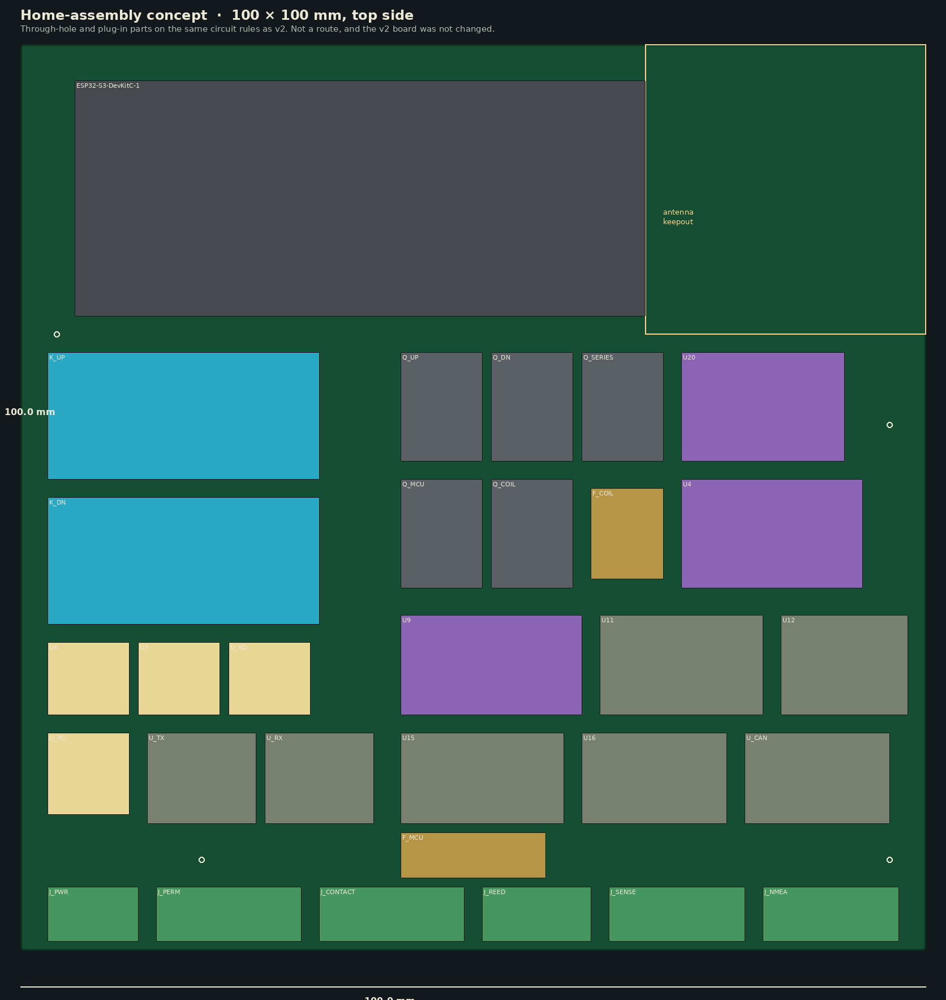
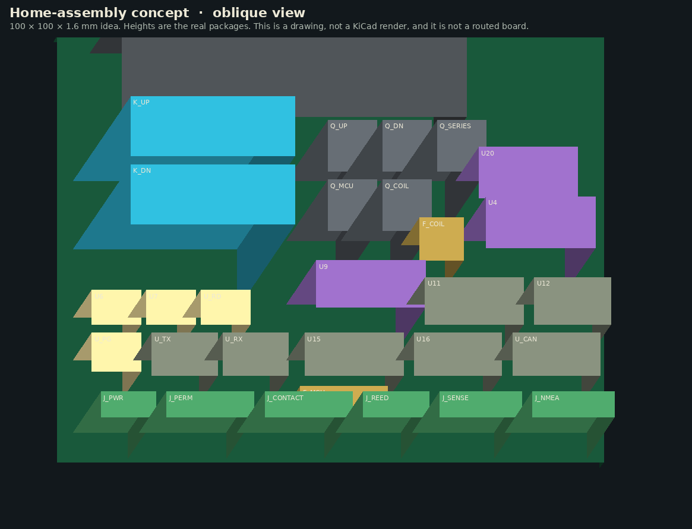

# Home-assembly concept

24 November 2026, Sydney time. This is a proposal for a through-hole controller that can be built with a soldering iron. It is not a schematic, not a route, and not an order.

`kicad11/windlass_install_v2.kicad_pcb` was not edited. The pictures are `docs/images/windlass_home_assembly_placement.png` and `docs/images/windlass_home_assembly_3d.png`. The parts are `docs/home_assembly_bom.csv`. Nothing here is permission to install the board on the boat. B1–B8 are unchanged.

## What the iron has to solder

Every part on this concept is through-hole, or it is a finished module with through-hole pins. There is no 0402, no SOT-23, and no SOIC for the builder to place.

The modules that arrive already assembled are the ESP32-S3 DevKitC-1, the Murata OKI-78SR buck, and the two Murata MEJ2 converters. Their internals are surface-mount. The builder solders pins and leads.

## What was dropped because the DevKit already has it

The DevKit provides the USB socket, the USB-to-UART bridge, the reset button, and the boot button. The GCT USB4105, the CC resistors, the USBLC6, the series resistors on D+ and D−, and the two tactile switches are not on this board.

Espressif’s v1.1 guide says the USB ports, the 5 V pin, and the 3V3 pin are mutually exclusive supplies. Program the DevKit from its own USB socket with the 12 V plug pulled out. On the boat, power comes in through the 5 V pin only.

Buy **ESP32-S3-DevKitC-1-N16R8**. The current image is built for 16 MB of flash with PSRAM left disabled. An N8 board is the wrong flash size. GPIO35, GPIO36, and GPIO37 are the octal-PSRAM pins on an N16R8 module and this design does not use them. Espressif’s own page gives a sample price of $17 and points at Mouser for the N16R8.

The board is 25.4 mm by 62.74 mm. The two headers are 22 pins at 2.54 mm, and the rows are 22.86 mm apart. Fit two female socket strips at that spacing. The antenna end sits in the keepout at the right-hand edge of the concept, with no copper and no screw under it.

## GPIO assignments, unchanged

The firmware map in `firmware/s3/include/windlass/gpio_map.hpp` is the one this concept wires. Header numbers are the Espressif v1.1 guide.

| Function | GPIO | DevKit pin |
| --- | --- | --- |
| Heartbeat | GPIO1 | J3 pin 4 |
| TWAI TX | GPIO4 | J1 pin 4 |
| TWAI RX | GPIO5 | J1 pin 5 |
| Reed | GPIO6 | J1 pin 6 |
| UP sense | GPIO7 | J1 pin 7 |
| DOWN sense | GPIO8 | J1 pin 12 |
| UP request | GPIO9 | J1 pin 15 |
| DOWN request | GPIO10 | J1 pin 16 |
| Coil rail | GPIO14 | J1 pin 20 |
| Red LED | GPIO15 | J1 pin 8 |
| Green LED | GPIO16 | J1 pin 9 |
| Publish read | GPIO18 | J1 pin 11 |
| 5 V in | — | J1 pin 21 |
| Ground | — | J1 pin 22, and J3 pins 1, 21, 22 |
| 3.3 V out | — | J1 pins 1 and 2 |

GPIO0, GPIO3, GPIO45, and GPIO46 are not connected. GPIO19 and GPIO20 stay on the DevKit USB port. GPIO43 and GPIO44 stay on the DevKit UART bridge. No firmware edit is required for the pin numbers.

## Power

One 12 V screw terminal, then two branches, as on v2. Each branch has a fuse and a P-channel TO-220 used as a reverse-polarity switch: drain toward the fuse, source toward the load, gate pulled to ground through 100 kΩ and clamped with a 12 V zener. Reverse battery turns the FET off, the TVS conducts, and the fuse opens.

The TVS is an axial 18 V, 600 W part (P6KE18A class), one on each branch. That clamp sits under 30 V. It is still not load-dump protection.

The MCU branch then feeds a **Murata OKI-78SR-5/1.5-W36H-C**. Newark lists it at $6.53. It is a horizontal SIP, 7 V to 36 V in, 5 V at 1.5 A, absolute maximum 36 V. A Recom R-78E5.0-1.0 is cheaper at $4.51 on DigiKey and is also a SIP, but its input range stops at 28 V and it is only 1 A. The TVS clamp can sit near that 28 V ceiling, and 1 A is tight when the DevKit is transmitting and both isolated converters are loaded. The OKI part is the one proposed.

The 5 V rail feeds the DevKit 5 V pin, the logic that has to drive the coil switches, and both MEJ2 modules. The DevKit’s own regulator makes the 3.3 V for the reed blanker and the GPIO pull-ups. That external 3.3 V load is a few milliamps.

Rough 5 V budget, so the 1.5 A rating can be checked:

| Load | About |
| --- | ---: |
| DevKit, Wi-Fi transmit, through its linear regulator | 400 mA |
| MEJ2S0505SC at the CAN preload, 72% minimum efficiency | 60 mA |
| MEJ2S0503SC at the reed preload, 67% minimum efficiency | 70 mA |
| Both 6N137 supplies and the HCT logic | 20 mA |

A transmit peak with the CAN driver dominant is still under 1 A. The 1.5 A module has room. These are datasheet scalings, not a measurement.

## Heartbeat and fail-off

The v2 watchdog is a 74LVC1G123. There is no DIP version of that chip. A 74HCT123 in DIP looks like the obvious replacement and is the wrong one for this firmware.

Nexperia 74HC/HCT123, Rev. 13, 21 February 2024, gives the typical pulse as tW = 0.45 × REXT(kΩ) × CEXT(pF) nanoseconds at 5.0 V. The same note gives a minimum time between retrigger edges, trtrig = 30 + 0.19 × REXT × CEXT, once the capacitor is large enough for that formula. The ratio 0.19 / 0.45 is 0.42. A 330 ms pulse would ignore a new edge for about 140 ms. The firmware produces a rising edge every 80 ms. Those edges would not keep the pulse alive, and the coil would drop out while the firmware still believed it was holding.

The concept splits the job:

- A CD74HCT123E produces only a 10 µs pulse. REXT is 10 kΩ and CEXT is 2.2 nF, so 0.45 × 10 × 2200 ns is 9.9 µs. The next heartbeat edge is 80 ms later, long after that pulse has ended, so the retrigger limit does not apply. Pin 1A is held low, pin 1RD is held high, and the rising edge is GPIO1 into pin 1B. The active-high output is pin 13. That pulse turns on a BC547, which discharges the timing capacitor. A stuck-high GPIO makes one pulse and then nothing.
- The timing capacitor is 1.0 µF film, charged from 5 V through 1.00 MΩ. A CD74HCT14E watches it. While repeated edges hold the capacitor down, the inverter output stays high and the series FET stays on. When the edges stop, the capacitor charges through the Schmitt threshold and the output goes low.

CD74HCT14 thresholds, TI datasheet, 4.5 V row: VT+ is 1.2 V minimum and 1.9 V maximum. The 5.5 V row maximum is 2.1 V. The bounds below use 1.2 V and 2.0 V at a regulated 5.0 V rail, with the capacitor starting between 0.1 V and 0.3 V after the discharge transistor.

t = −RC ln((5.0 − VT) / (5.0 − V0)), with RC = 1.0 s.

| Case | Result |
| --- | ---: |
| Short, VT+ 1.2 V, start 0.1 V | 254 ms |
| Long, VT+ 2.0 V, start 0.3 V | 449 ms |
| Same pair with a ±10% film capacitor | 229 ms to 494 ms |

229 ms still covers two 80 ms periods, so one missed edge does not drop the coil. 494 ms is the same kind of long case as the 475 ms figure on v2. This is a datasheet bound. The pulse is still measured on the first board, which is the existing B7 check.

A static level does not hold the series FET on. GPIO1 has a 100 kΩ pulldown, so reset and a high-impedance pin are off. If 5 V is absent, the FET gate is held down by its own 100 kΩ. The HCT123 can fire once at power-up. Both request pins are pulled down, so both low-side FETs are off, and that single interval does not pull in a coil.

## Coil drive and the cross-interlock

v2 uses ZXMS6004FF because a GPIO high is only guaranteed at 0.8 × 3.27 V, which is 2.62 V, and the ZXMS on-level is 3.0 V. The 74LVC1G34 exists to close that gap. A DIP buffer can close it from the other direction.

CD74HCT125E runs from 5 V. Its high input threshold is 2.0 V, so the ESP32 floor of 2.62 V is a legal high, with 0.62 V of margin. Its low threshold is 0.8 V, and the ESP32 low floor on that rail is 0.33 V. The output high at 20 µA is 4.4 V minimum. Each request goes through 220 Ω into an IRLZ44NPBF gate, with 100 kΩ to ground. The pulldown takes about 45 µA, so the gate sits essentially on that 4.4 V number.

Infineon IRLZ44N publishes RDS(on) of 35 mΩ maximum at VGS = 4.0 V and 25 mΩ maximum at 5.0 V. 4.4 V is above the 4.0 V line. DigiKey lists IRLZ44NPBF at $1.80. The tab is the drain. Do not bolt the tabs to a grounded plate or to each other.

At 42 mA the drop across 35 mΩ is about 1.5 mV. The Finder coil still sees the rail, against an 8.8 V pickup. Three of these FETs replace Q_UP, Q_DN, and Q_SERIES. The series FET is the one driven by the Schmitt output, through 220 Ω, with the same 100 kΩ pulldown.

The cross-clamp is a BC547, not a small MOSFET. Each buffer output also drives the opposite clamp through 4.7 kΩ into the base. When the other request is high, that transistor saturates and holds this gate near 0.2 V, which is under the 1.0 V minimum threshold of the IRLZ44N. Both requests high holds both gates off. The fight current is about 4.4 V / 220 Ω, about 20 mA, under the 35 mA absolute maximum of the 74HCT125. In normal use the 220 Ω carries only the pulldown current.

A shorted coil lead is the case where this concept differs from the ZXMS. The ZXMS current-limits and waits for the fuse. A fully enhanced IRLZ44N does not current-limit. The fuse resistance and the wiring set the current, which is amps, and a fast 250 mA fuse then opens. While the FET is fully on, its own dissipation during that interval is small. This is safe only because the gate is at 4.4 V, where the on-resistance is specified. A 3.3 V GPIO tied straight to this gate is not that circuit and is not proposed.

The 250 mA fuse is a 5×20 mm fast-blow in clips, not the Littelfuse 0466.250. The 0.0022 A²s figure belongs to that 1206 part and is not claimed for the 5×20 mm fuse. Opening time on a shorted lead is a first-article check. One coil at 42 mA, or both at 18 V (125 mA), stays under a 250 mA fuse. The MCU fuse is a 2 A 5×20 mm fast-blow.

Flyback diodes are 1N5819 across the Finder coils only. Nothing on the board joins COM to NO. The contactor diode stays at the contactor, after that contactor has been looked at, which is the installation rule already written down. The SMBJ that v2 places across each contact is left off this concept: a TVS that fails short would hold that contactor on.

The coil-rail detector is the same divider: 100 kΩ from the coil feed, 100 kΩ to ground, a BAT46 clamp toward the 3.3 V pin, and 1 kΩ to GPIO14. High means the rail is present, which is what the firmware reads.

## Isolation

`REED_RET`, `UP_RET`, `DN_RET`, and `GND_CAN` are not joined to each other or to board ground. The concept is a two-layer board so those gaps are visible. Barrier tracks stay on the top layer. A slot goes under each optocoupler and under each MEJ2 module. A slot alone does not replace a keepout: the ground pour stops at the barrier as well.

This is functional isolation, the same limit as v2. It is not a safety barrier, and the windlass safety case cannot rest on it.

### Reed

The isolated rail is a **MEJ2S0503SC**, 5 V in and 3.3 V out, because the board rail is now 5 V. v2 used a MEJ2S0303SC from 3.3 V. The output, the 51 Ω preload, and the Murata rating do not change: about 65 mA, about 0.21 W in a 1 W axial resistor, 5.2 kVDC hipot for one second, 2.4 kVDC continuous functional. The preload is just over 10% of the 606 mA rating. A price for the 0503 was not on the page that listed the 0505 at $15.39.

The Lofrans network is unchanged: 10 kΩ in series, 47 kΩ to `REED_RET`, BAT46 clamps to the isolated 3.3 V and to `REED_RET`, and the three-pin shunt that selects Lofrans or the dry contact. The 4.7 kΩ pull-up stays on the dry-contact pin only.

A PC817 cannot be hung directly on that node. The Lofrans source is a voltage into 10 kΩ, not an LED current. A BC557 on the isolated side takes the conditioned node and drives the PC817 LED at about 2 mA. The LED is on when the node is low and off when it is high, so the MCU-side pull-up makes GPIO follow the node: idle low, active high, which is the edge the firmware counts.

A second PC817 has its LED across the isolated 3.3 V, so it conducts only while that rail is up. That is the power-good the ISO7720 OUTB provides today.

The blanker keeps the rules written on the reed sheet. A 74HC00 SR latch and a 74HC08, powered from the DevKit 3.3 V pin:

- Field-supply loss sets the latch and holds GPIO6 low. That is a falling edge. The firmware does not count it.
- The latch clears only when power-good is high and the reed data is low.
- The following rise is what reaches GPIO6.
- Until the first real low after power-up, GPIO6 stays low. The firmware samples that level and does not treat the sample as an edge.

### Direction

Two more DIP optocouplers replace the TLP291 pair. The LED resistors stay 4.7 kΩ. At 12 V the LED current is about 2.3 mA, and at 24 V about 4.9 mA. The returns stay separate and are not board ground. A 1N4148 sits anti-parallel across each LED. The phototransistor is active low into GPIO7 and GPIO8 with 10 kΩ to 3.3 V. No isolated supply is added on these inputs.

### CAN

A preassembled “isolated CAN module” was looked at and not proposed. The boards that turn up are either a Raspberry Pi SPI board (MCP2515 or MCP2518, the wrong pins and the wrong connector) or a small ISO1050 plus an unbranded B0505-class converter. Those modules usually fit the 120 Ω terminator this board must not carry, they have no publish jumper, and the converter is the class already refused for v2. ISO1050 itself is SOIC only.

The concept builds the same function from parts with leads:

- MEJ2S0505SC, 5 V to isolated 5 V. DigiKey 811-2397-ND lists it at $15.39. v2 used MEJ2S0305SC from 3.3 V. The 120 Ω preload, about 42 mA and 0.21 W, stays across the isolated 5 V and is not across CANH/CANL. JP1 in the primary stays open until someone fits the shunt. GPIO18 only reads that node, through 10 kΩ. A GPIO driven high cannot run the converter.
- MCP2562-E/P, DIP-8, on the isolated 5 V. DigiKey UK lists it at £0.98. STBY is held low. TXD has a pull-up to the isolated 5 V, so an unpowered or idle input is recessive. No 120 Ω is fitted on CANH/CANL. NET-S is open. The shield capacitor goes to `GND_CAN` only.
- Two Vishay 6N137-000E, DIP-8. DigiKey’s listing carried by an 11 November 2026 aggregator is $2.38. Isolation is 5300 Vrms for one minute, creepage at least 7 mm on the DIP-8. Propagation is 75 ns maximum at 7.5 mA. At 250 kbit/s a bit is 4 µs, so a transmit opto and a receive opto in the round trip are a small part of a bit.

Polarity, so the firmware does not change. TWAI idle is high, and high is recessive. The transmit LED is wired from 3.3 V to GPIO4, so a high pin turns the LED off, the open-collector output releases, and the pull-up makes TXD high. A low pin turns the LED on and pulls TXD low, which is dominant. The LED current is about 7 mA with 270 Ω, above the 5 mA threshold maximum and under the 20 mA absolute maximum. The receive LED is on the isolated side, on when RXD is low. Its open-collector output is powered from 5 V, as the 6N137 requires, and the pull-up is to 3.3 V, so GPIO5 never sees 5 V. Recessive is high on GPIO5.

## Parts that have no through-hole version

These are the families a reviewer might still want, and none of them is in this proposal:

| v2 part | Why it has no DIP | What this concept does |
| --- | --- | --- |
| ESP32-S3-WROOM-1-N16, USB4105, USBLC6 | Module and connector are SMD | DevKit, already built |
| AP63203 and the shielded inductor | The converter and the coil are SMD | OKI-78SR module |
| ISO1042 | SOIC-16W only | 6N137 pair and MCP2562-E/P |
| ISO7720 | SOIC-8 only | Two PC817s and the DIP blanker |
| 74LVC1G123, 74LVC1G34, 74LVC1G00 | Single-gate SMD only | DIP HCT and HC, with the watchdog rebuilt |
| ZXMS6004FF and NX3008 | SOT-23 only | IRLZ44N at 4.4 V, BC547 clamps |

If a review wants the TI isolators or the ZXMS specifically, those are the parts that would have to be soldered as SMD, or bought on a breakout the builder did not assemble. That is a different concept.

## Size

The outline in the picture is **100.0 × 100.0 mm**, 1.6 mm, two layers, parts on the top. Four M3 holes are drawn where they miss the DevKit, the antenna keepout, and the screw terminals. The antenna keepout is the right-hand 31 mm of the top 32 mm. No copper and no screw there. Espressif’s 15 mm clearance to a metal case is still an enclosure question, the same B6 item.

JLCPCB’s published 2-layer price starts at $2 for five boards at or under 100 × 100 mm. That is the published starting price, not a quote for this board, and it does not include shipping. Growing the board past that size to give the terminals more finger room is reasonable and is the thing that drops the board out of that price. Ease of soldering was preferred over a smaller outline, and 100 mm is as small as this set of packages sits without stacking parts on top of each other. The picture has no overlapping outlines.

The connectors along the bottom edge are the v2 housings, in the same order a wiring schedule already uses: power, permissive, contacts, reed, sense, NMEA.

## Cost for one controller

Listings, not a cart and not a reservation. USD unless the cell says otherwise. The small-parts line is an allowance, not a distributor total.

| Line | USD |
| --- | ---: |
| DevKitC-1-N16R8, Espressif sample price | 17.00 |
| OKI-78SR-5/1.5-W36H-C, Newark | 6.53 |
| MEJ2S0505SC, DigiKey | 15.39 |
| Two Finder 40.31.7.012.0000, Newark listing of 23 Nov 2026 at $8.46 | 16.92 |
| Two 6N137-000E, DigiKey figure from 11 Nov 2026 at $2.38 | 4.76 |
| Three IRLZ44NPBF, DigiKey at $1.80 | 5.40 |
| CD74HCT14E, Mouser | 0.83 |
| Axial parts, four optocouplers, the remaining DIP logic, sockets, headers, fuses, clips, and the six housings | 25.00 |
| Priced lines plus that allowance | 91.83 |

Not in that sum:

- MEJ2S0503SC. The 0505 on the same DigiKey family page is $15.39. The 0503 price was not on the page retrieved here.
- Two P-channel TO-220 FETs. Not priced.
- MCP2562-E/P. DigiKey UK lists £0.98.
- Five bare boards. The published 2-layer starting price is $2, plus shipping.
- Postage, tax, and the shunt.

The two Murata modules are most of the parts cost that does not shrink by leaving JLCPCB. What this concept removes is the assembly setup, the stencil, and the feeder loading. On the two-board Standard order those process lines are about $105 before any part is counted, and JLCPCB will not assemble a single board. A home-built controller is one board, bought as single pieces, with no assembly fee.

TME listed the Finder relay at $3.99 each for ten pieces on 23 November 2026. Two relays bought that way would replace $16.92 with $7.98. That break is real only if ten are actually purchased.

## Pictures

The oblique view is a drawing at the package heights. It is not a KiCad render, and there is no board file behind it.

## Before anyone routes this

A route should wait until these choices are accepted or replaced:

1. DevKitC-1-N16R8 on sockets, USB used only with the 12 V plug out.
2. OKI-78SR instead of the Recom R-78E, for the 36 V input and the 1.5 A rating.
3. MEJ2 modules moved to 5 V input. Same series, same isolation wording, different order codes.
4. The watchdog is a Schmitt RC reset by a 10 µs one-shot, not a 74HCT123 timed for 330 ms.
5. IRLZ44N coil switches, fully on at 4.4 V, with the fuse clearing a short. This is not the ZXMS current limit.
6. No SMBJ across the relay contacts.
7. CAN built from 6N137, MCP2562-E/P, and MEJ2S0505SC, with no terminator and the publish jumper open.
8. Two-layer 100 × 100 mm, or a larger board if the terminals need more room.
